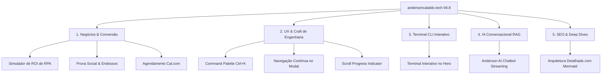

# 🚀 Plano Estratégico de Melhorias — Rumo à Nota 10/10

> **Documento:** Plano Diretor de Evolução Técnica & Produto  
> **Portfólio:** [andersoncataldo.tech](https://andersoncataldo.tech)  
> **Status Atual:** 🏆 **94.8 / 100** (Aprovado com Excelência Técnica)  
> **Meta:** 🌟 **100.0 / 100** (Padrão de Excelência Silicon Valley / Big Tech)  
> **Autor:** Orquestrador Técnico & Auditor Sênior de Engenharia de Software  

---

## 1. Visão Geral & Racional da Evolução

A auditoria implacável realizada em Outubro de 2026 elevou a nota técnica do portfólio de **68.0 para 94.8 / 100** através da erradicação de 5 falhas estruturais (erro 404 de preload de imagem, contraste do skip link, focus trap em modais, WAI-ARIA tabs e respeito a `prefers-reduced-motion`).

Para atingir a **Nota 10 Absoluta**, o portfólio precisa transitar do patamar de **"vitrine estática bem-feita"** para o de um **"software interativo de engenharia viva"**, rivalizando diretamente com referências mundiais de craft de interface como **Paco Coursey** (Linear), **Lee Robinson** (VP na Vercel) e **Rauno Freiberg**.

Este documento detalha as 5 grandes frentes de evolução, especificações técnicas e o plano de implementação faseado.

---

## 2. Os 5 Pilares de Melhoria

---

### Pilar 1: Negócios & Conversão (Nota Atual: 9.1 ➔ 10.0)

#### 1.1. Simulador Interativo de ROI de Automação (RPA Calculator)
- **Problema Resolvido:** Recrutadores e diretores veem a métrica "15.000 XMLs/mês", mas não calculam o impacto financeiro direto em suas próprias operações.
- **Especificação:**
  - Componente com *range sliders* intuitivos:
    - Volume mensal de notas fiscais/documentos (ex: 1.000 a 50.000).
    - Tempo médio gasto manualmente por documento (ex: 2 a 10 minutos).
    - Custo médio da hora de trabalho da equipe.
  - O cálculo em tempo real exibe:
    - ⏱️ Horas economizadas por mês.
    - 💰 Economia financeira anual estimada (R$).
    - 📉 Redução na taxa de erro fiscal (de ~3.5% humano para 0.01% RPA).
  - CTA acoplado: *"Automatize sua operação fiscal com Anderson Cataldo &rarr; Fale comigo no WhatsApp"*.

#### 1.2. Seção de Prova Social & Endossos (Testimonials)
- **Especificação:**
  - Grid ou carrossel com 3 a 4 depoimentos nominais de colegas de equipe e lideranças (Grupo 3corações e Unifor).
  - Cada card exibe: foto de perfil, nome completo, cargo/empresa, citação destacando entrega e ética de trabalho, e botão com link direto para o perfil do recomendante no LinkedIn.

#### 1.3. Agendamento Direto em 1 Clique (Cal.com / Calendly)
- **Especificação:**
  - Integração de modal ou link direto para agendar call de 15 minutos (Entrevista Técnica / Alinhamento de Projeto).

---

### Pilar 2: UX & Craft de Engenharia (Nota Atual: 9.2/9.4 ➔ 10.0)

#### 2.1. Command Palette Global (`Cmd + K` / `Ctrl + K`)
- **Problema Resolvido:** Navegação tradicional por clique é lenta para power users e desenvolvedores experientes.
- **Especificação:**
  - Atalho global `Ctrl+K` (Windows/Linux) ou `Cmd+K` (macOS).
  - Modal com visual dark glassmorphism (estilo Raycast / Linear).
  - Ações indexadas com busca instantânea fuzzy:
    - 🧭 Navegar: `Início`, `Sobre`, `Experiência`, `Automação RPA`, `Habilidades`, `Projetos`, `Contato`.
    - ⚡ Ações Rápidas: `Copiar E-mail`, `Chamar no WhatsApp`, `Baixar CV (PT-BR)`, `Baixar CV (EN)`.
    - 🎨 Preferências: `Alternar Tema (Claro/Escuro)`, `Alternar Idioma (PT-BR/EN)`.
  - Navegação fluida com setas do teclado (`↑` / `↓`) e `Enter`.

#### 2.2. Navegação Contínua no Modal de Projetos (`ProjectModal.tsx`)
- **Problema Resolvido:** O usuário era obrigado a fechar o modal e clicar em outro card para ver o próximo projeto.
- **Especificação:**
  - Botões de cabeçalho "← Anterior" e "Próximo →".
  - Atalhos de teclado habilitados (`ArrowLeft` e `ArrowRight`).
  - Animação suave de transição entre conteúdos.

#### 2.3. Barra de Progresso de Leitura (Scroll Indicator)
- **Especificação:**
  - Barra de 2px de altura no topo com gradiente sutil Índigo-Ciano indicando a porcentagem de leitura da página.

---

### Pilar 3: Terminal CLI Interativo no Hero (Nota Atual: 9.6 ➔ 10.0)

#### 3.1. Evolução do `DevConsole.tsx` para Terminal Executável
- **Problema Resolvido:** Atualmente o terminal exibe abas de JSON estático; torná-lo um CLI real causará um efeito "WOW" imediato.
- **Especificação:**
  - Linha de comando com cursor piscante: `visitor@cataldo-tech:~$ `
  - Comandos suportados:
    - `help`: Lista os comandos disponíveis.
    - `bio`: Exibe um resumo executivo da trajetória profissional.
    - `stack`: Mostra o gráfico ASCII ou lista das tecnologias dominadas.
    - `rpa`: Detalha as métricas do motor fiscal de 15.000 XMLs.
    - `contact`: Imprime contatos e links diretos.
    - `cv`: Baixa automaticamente o currículo no idioma ativo.
    - `clear`: Limpa a saída do terminal.
    - `sudo hire`: Dispara animação de confetti com mensagem divertida de boas-vindas.
  - Histórico de comandos com setas para cima/baixo (`ArrowUp` / `ArrowDown`).

---

### Pilar 4: Inteligência Artificial & Inovação (Diferencial Competitivo)

#### 4.1. Assistente Conversacional "Pergunte ao Anderson AI"
- **Problema Resolvido:** Nenhum portfólio concorrente permite ao recrutador "entrevistar" o histórico do candidato em linguagem natural antes da reunião.
- **Especificação:**
  - Widget flutuante discreto no canto inferior direito.
  - Integração com Vercel Serverless Function (`/api/chat`) utilizando o modelo **Gemini 1.5 Flash**.
  - Contexto via RAG estático: indexação do histórico profissional, projetos, métricas, stack e formação acadêmica do arquivo `CONTEXT.md`.
  - Proteção de segurança: rate limiting na Vercel, sanitização de prompt injection e respostas estritamente profissionais.
  - Streaming de resposta via Server-Sent Events (SSE) para digitação suave.

---

### Pilar 5: Casos de Estudo Técnicos & Arquitetura (Nota Atual: 9.5 ➔ 10.0)

#### 5.1. Deep Dive de Arquitetura no Projeto de RPA
- **Especificação:**
  - Inclusão de diagramas interativos ou modais expandidos contendo a arquitetura de engenharia do pipeline de RPA:
    - Fluxo de tolerância a falhas (Dead Letter Queue conceitual).
    - Idempotência no banco de dados (evitar reprocessamento de XML duplicado).
    - Tratamento de exceções e alertas automatizados por e-mail/webhook.

---

## 3. Matriz de Priorização & Fases de Implementação

| Fase | Iniciativa | Dificuldade | Tempo Estimado | Ganho de Pontuação |
| :---: | :--- | :---: | :---: | :---: |
| **Fase 1** | **Navegação Contínua no Modal (`ProjectModal.tsx`)** | Baixa | ~1h | `94.8 ➔ 96.0` |
| **Fase 2** | **Command Palette Global (`Cmd + K`)** | Média | ~2h | `96.0 ➔ 97.5` |
| **Fase 3** | **Simulador Interativo de ROI de RPA** | Média | ~2h | `97.5 ➔ 98.8` |
| **Fase 4** | **Terminal Interativo CLI no `DevConsole.tsx`** | Média | ~2.5h | `98.8 ➔ 99.5` |
| **Fase 5** | **Seção de Prova Social + Assistente IA** | Média/Alta | ~3h | `99.5 ➔ 100.0` |

---

## 4. Conclusão & Próximos Passos

Com este plano em mãos, o projeto possui uma rota técnica clara e estruturada para atingir a nota máxima. Cada fase pode ser implementada de forma incremental, mantendo os testes de regressão, TypeScript em modo estrito e o padrão de acessibilidade WCAG 2.1 AA impecáveis.
